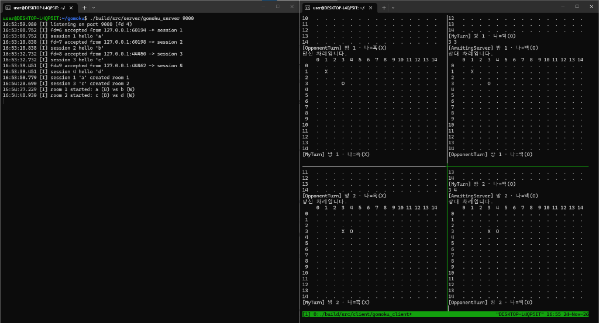

# mujinkr

컴퓨터공학 전공생의 프로젝트 포트폴리오입니다.

- **닉네임**: mujinkr
- **관심 분야**: 비동기, 서버 프로그래밍, TCP/IP 소켓, 문서 자동화
- **GitHub**: [mujinkr GitHub 프로필](https://github.com/mujinkr)

## 대표 프로젝트: Gomoku Multiplayer

TCP 위에서 동작하는 C++20 / Linux `epoll` 기반 오목 멀티플레이어 게임 서버와 `poll` 기반 터미널 클라이언트입니다. 소켓 프로그래밍의 동작 원리를 직접 구현하며 학습하기 위해 Windows WinSock 1:1 에코 프로그램에서 시작해 Linux 단일 스레드 이벤트 루프 서버와 터미널 클라이언트까지 단계적으로 확장했습니다.

### 문제 정의

TCP는 메시지 경계가 없는 바이트 스트림이며, 논블로킹 소켓 환경에서는 송수신이 한 번에 완료되지 않을 수 있습니다. 이 프로젝트는 다음 문제를 직접 설계하고 해결하는 것을 목표로 했습니다.

- 분할·병합되어 도착하는 TCP 바이트 스트림을 길이 프리픽스 바이너리 프레임으로 복원하고, 부분 전송을 송신 버퍼와 쓰기 이벤트로 처리하는 통신 계층 구현
- 단일 스레드 `epoll` 이벤트 루프 위에서 다중 클라이언트 접속, 로비(방 생성·목록·입장), 여러 방의 동시 대국 상태를 안전하게 관리하는 서버 구조 설계
- 오류 종료 시 마지막 응답 유실 방지(`closeAfterFlush`), 이벤트 처리 중 세션 파괴를 피하는 지연 닫기, `signalfd`를 통한 정상 종료 처리
- 클라이언트에서 표준 입력(`stdin`)과 소켓 I/O를 `poll`로 함께 다루면서 입력 장치와 상태 머신(`Intent -> ClientCore -> Effects`)을 분리하는 구조 설계

### 역할

개인 프로젝트로 서버, 바이너리 프로토콜, 터미널 클라이언트, 자동 테스트 스크립트의 설계와 구현 전 과정을 단독으로 수행했습니다.

- `EventLoop`(`epoll`), `Listener`, `Server`, `Session`, `Room`, `RoomManager`, `Game`으로 책임을 분리한 서버 구현
- `FrameParser`, `codec`(big-endian 직렬화), 서버·클라이언트 공용 `Connection` 통신 계층 구현
- `poll` 기반 터미널 클라이언트(`TerminalInput`, `ClientCore`, `TerminalRenderer`) 구현
- 단위 테스트(`doctest`)와 Python 기반 프로세스 인수 테스트 작성

### 기술

| 구분 | 사용 기술 |
| --- | --- |
| 언어 및 표준 | C++20 (`g++ 11.4.0`), Python 3.10+ (인수 테스트) |
| 네트워크 및 OS I/O | Linux `epoll`, `poll`, `signalfd`, `accept4`, 논블로킹 TCP 소켓 |
| 프로토콜 | 길이 프리픽스 바이너리 프레임 (big-endian, 최대 payload 4096바이트) |
| 빌드 및 라이브러리 | CMake 3.22+, `fmt` (`libfmt-dev`), `doctest` |
| 환경 및 분석 도구 | Linux (WSL2 Ubuntu 22.04.5 LTS), AddressSanitizer, UBSan |

### 결과

단일 `gomoku_server` 프로세스에 클라이언트 4명(`a`, `b`, `c`, `d`)이 접속해 방 2개(`방 1`, `방 2`)에서 동시에 대국을 진행한 실행 결과입니다.



- 왼쪽 터미널(서버): 포트 `9000`에서 세션 4개를 수락하고, `room 1`(`a` vs `b`)과 `room 2`(`c` vs `d`)의 생성 및 대국 시작을 로그로 기록합니다.
- 오른쪽 터미널(클라이언트 4개): 각 방의 흑(`X`)·백(`O`) 클라이언트에서 착수 결과가 양측 15x15 보드에 동기화되고, 상태 표시가 `[MyTurn]`, `[AwaitingServer]`, `[OpponentTurn]`으로 전환됩니다.

### 실행 방법 및 예시

Linux 전용 시스템 콜(`epoll`, `signalfd`, `accept4`)을 사용하며, 아래 명령은 검증된 WSL2 Ubuntu 22.04.5 LTS(`g++ 11.4.0`, `CMake 3.22+`) 환경 기준입니다.

1. 저장소를 내려받고 필수 패키지를 설치한 뒤 빌드합니다.

   ```bash
   git clone https://github.com/fromzero000/gomoku-multiplayer.git
   cd gomoku-multiplayer
   sudo apt install build-essential cmake libfmt-dev
   cmake -S . -B build
   cmake --build build -j
   ```

2. 터미널 3개를 열어 서버 1개와 클라이언트 2개를 실행합니다.

   ```bash
   # 터미널 1: 서버 실행
   ./build/src/server/gomoku_server 9000

   # 터미널 2: 흑 플레이어
   ./build/src/client/gomoku_client 127.0.0.1 9000 alice
   > create            # 방 생성, 상대 대기

   # 터미널 3: 백 플레이어
   ./build/src/client/gomoku_client 127.0.0.1 9000 bob
   > list              # 방 목록 조회
   > join 1            # 방 입장 및 대국 시작
   > 7 7               # 착수: row col (0~14)
   ```

지원하는 클라이언트 명령어는 `list`, `create`, `join <번호>`, `leave`, `<row> <col>`, `ping`, `help`, `quit`입니다. 단위 테스트, 인수 테스트, Sanitizer 빌드 등 자세한 안내는 [Gomoku Multiplayer README](https://github.com/fromzero000/gomoku-multiplayer#readme)에서 확인할 수 있습니다.

### 소스 코드

- [Gomoku Multiplayer GitHub 저장소](https://github.com/fromzero000/gomoku-multiplayer)

## 이력서 (PDF)

- <a href="assets/mujinkr-portfolio.pdf" download>포트폴리오 이력서 PDF 다운로드</a>
